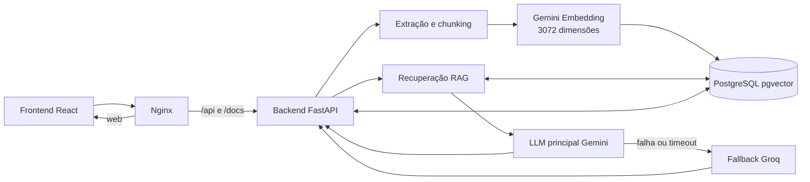

# AdaptAI

> **Aprenda no seu ritmo.** Documentação técnica convertida em experiências de estudo personalizadas.

[](https://python.org) [](https://fastapi.tiangolo.com) [](https://react.dev) [](https://typescriptlang.org) [](https://docker.com) [](.github/workflows/ci.yml)

**AdaptAI** é uma plataforma EdTech do **Hackathon ONE G10**, iniciativa da Oracle Next Education (ONE) com a Alura.

## Visão geral

O projeto reduz o esforço de transformar documentação extensa em estudo dirigido. A plataforma ingere documentos, recupera trechos relevantes com RAG e gera materiais personalizados com base nas fontes: **flashcards, quizzes, resumos, tutoriais e roteiros de aula**. Também mantém histórico e oferece evolução por XP e testes de nível.

## Arquitetura e inteligência artificial

### Pipeline RAG

1. **Extração:** PDF via pdfplumber; TXT e Markdown via decodificação UTF-8.
2. **Chunking determinístico:** blocos de **900 caracteres**, com **150 caracteres de sobreposição** (passo 750). O identificador persistido é um SHA-256 determinístico derivado do documento, da posição e do texto do chunk.
3. **Vetorização:** Gemini `gemini-embedding-001`, com **3072 dimensões** e tarefas `RETRIEVAL_DOCUMENT` / `RETRIEVAL_QUERY`.
4. **Persistência e busca:** texto, metadados e embeddings no **PostgreSQL com pgvector**; recuperação por distância de cosseno, limitada aos documentos do usuário.
5. **Contexto:** até 12 chunks podem ser enviados integralmente; acima disso, a geração usa recuperação semântica top-k. Os itens podem referenciar chunks usados e o backend calcula métrica de ancoragem às fontes.

### Resiliência multi-LLM

A cadeia usa **Gemini como principal** e **Groq como fallback**, quando configurado. Falhas transitórias, timeout, indisponibilidade, resposta vazia ou JSON inválido acionam o próximo provedor. O orquestrador controla a troca e os SDKs não fazem retentativas automáticas.

Os modelos e timeout são configuráveis. No `.env.example` versionado, o timeout é **60 segundos** e o modelo Groq é `openai/gpt-oss-20b`; o código também tem padrões internos de configuração. Para limitar cada chamada principal a **5–10 segundos**, configure `LLM_TIMEOUT_S=5` ou `LLM_TIMEOUT_S=10`; o fallback só começa depois que a chamada principal retorna erro ou expira. Como a execução é sequencial, o projeto não promete troca em milissegundos. Modelos como `llama-3.3-70b` ou `openai/gpt-oss-120b` só devem ser configurados se estiverem disponíveis na conta Groq. Embeddings usam Gemini e não têm fallback Groq.

### Validação estruturada

Schemas Pydantic por formato são enviados ao Gemini como JSON schema e validados novamente no backend. Campos extras e estruturas inválidas são rejeitados; pode haver uma tentativa de correção antes de avançar na cadeia. Isso garante aderência estrutural ao contrato, não a correção factual por si só.

### Gamificação

| Evento | XP |
| --- | ---: |
| Primeiro upload de documento |  10 |
| Geração de material |  5 |
| Acerto em quiz |  15 |
| Erro em quiz | -2 |

O XP de upload não se repete para o mesmo documento e o total não cai abaixo de zero. Limiares do Teste de Nível: **100, 300, 700 e 1500 XP**; modo demo reduz os limiares por fator 0,1. Níveis canônicos: Iniciante, Básico, Intermediário, Avançado e Especialista. A IA gera cinco questões fundamentadas em documentos do usuário; o gabarito não é exposto antes da correção e a aprovação pode promover o nível.

## Stack tecnológica

| Camada | Tecnologias |
| --- | --- |
| Backend/API | Python 3.11+, FastAPI, Pydantic v2, SQLAlchemy 2, Alembic, Uvicorn |
| Frontend | React 19, TypeScript 5.9, Vite, React Router, Bootstrap 5 |
| Banco | PostgreSQL 16, pgvector |
| RAG/IA | pdfplumber, Google GenAI SDK, Gemini, Groq |
| Segurança | JWT, bcrypt |
| Infraestrutura | Docker, Docker Compose, Nginx |
| Qualidade | pytest, Ruff, Vitest, ESLint, TypeScript, GitHub Actions, OpenAPI |

## Diagrama de arquitetura



## Funcionalidades principais

- Cadastro, login e rotas protegidas com **JWT**.
- Upload de PDF, TXT e Markdown com extração, chunking e indexação.
- Geração dos cinco formatos de estudo personalizados.
- Histórico de documentos e adaptações.
- Busca semântica em material do usuário.
- XP, níveis e Teste de Nível gerado pela IA.
- Acesso demo por conta seed e atalho condicional no login.

## Como executar com Docker

### Pré-requisitos

Docker Engine/Desktop com Compose v2; chave Gemini para geração e embeddings; chave Groq para fallback; portas 80 e 8000 livres.

### Configuração

Copie `.env.example` para `.env`:

```bash
cp .env.example .env
```

No PowerShell: `Copy-Item .env.example .env`.

| Variável essencial | Finalidade |
| --- | --- |
| `JWT_SECRET` | Segredo forte para assinatura dos tokens. |
| `POSTGRES_USER`, `POSTGRES_PASSWORD`, `POSTGRES_DB` | Acesso e nome do banco; a senha deve ser alfanumérica no Compose atual. |
| `LLM_PROVIDER`, `LLM_MODEL`, `LLM_API_KEY` | Provedor/modelo principal e chave Gemini. |
| `LLM_FALLBACK_PROVIDER`, `LLM_FALLBACK_MODEL`, `GROQ_API_KEY` | Provedor/modelo e chave Groq reserva. |
| `LLM_TIMEOUT_S` | Timeout individual (60 no exemplo atual). |
| `EMBEDDING_MODEL`, `EMBEDDING_DIM` | `gemini-embedding-001` e `3072`. |
| `CORS_ORIGINS`, `MAX_UPLOAD_MB` | Origens permitidas e tamanho máximo de upload. |

Os valores do arquivo de exemplo são placeholders. Nunca versione o `.env` real.

### Inicializar

```bash
docker compose up -d --build
```

O Compose inicia PostgreSQL/pgvector, backend, frontend e Nginx. O backend executa migrações Alembic e tenta rodar o seed demo.

- Frontend: [http://localhost](http://localhost)
- Swagger: [http://localhost/docs](http://localhost/docs)
- Health: [http://localhost:8000/api/v1/health](http://localhost:8000/api/v1/health)

O frontend usa variáveis `VITE_*` em tempo de build. No Dockerfile atual, `VITE_API_URL` usa o padrão `/api/v1` e `VITE_USE_MOCK` não é definido durante o build, então o cliente usa HTTP real por padrão. As variáveis injetadas no serviço frontend pelo Compose são de runtime e não reconfiguram o bundle já compilado. Para habilitar mocks ou alterar a URL no Compose, ajuste o build do frontend para passar os argumentos correspondentes; para desenvolvimento com Vite, configure `frontend/.env`. Diagnóstico: `docker compose ps` e `docker compose logs -f backend`.

## Feature Demo

[backend/scripts/seed_demo.py](backend/scripts/seed_demo.py) tenta criar idempotentemente `demo@adaptai.com.br` após as migrações. Se o seed falhar, registra um aviso e o Compose continua iniciando; nesse caso, o usuário não estará disponível. Credenciais iniciais locais:

- **E-mail:** `demo@adaptai.com.br`
- **Senha:** `demo123`

O botão de login demo só aparece com `VITE_DEMO_ENABLED=true`, `VITE_DEMO_EMAIL` e `VITE_DEMO_PASSWORD` no build frontend. O Compose/Dockerfile atual não repassa essas variáveis ao build, então é possível entrar digitando as credenciais seed, mas o botão não aparece por padrão. Para desenvolvimento com Vite, configure `frontend/.env`; para ativá-lo na imagem, passe os valores como argumentos de build. Como variáveis `VITE_*` ficam públicas no bundle, use somente credenciais descartáveis de demonstração e nunca credenciais de produção. A senha seed é somente para demonstração local.

## Estrutura de pastas

```text
├── 📁 .github
│   └── 📁 workflows             # CI, política de PR e release
├── 📁 backend
│   ├── 📁 app
│   │   ├── 📁 agents            # Orquestração LLM e prompts
│   │   ├── 📁 api               # Rotas, autenticação e erros
│   │   ├── 📁 core              # Segurança
│   │   ├── 📁 infra
│   │   │   ├── 📁 db            # Modelos e sessão PostgreSQL
│   │   │   └── 📁 llm           # Adaptadores Gemini, Groq e fake
│   │   ├── 📁 ports             # Contratos das integrações
│   │   ├── 📁 rag               # Extração, chunks, embeddings e busca
│   │   ├── 📁 schemas           # Contratos Pydantic
│   │   ├── 📁 services          # Ingestão, adaptação, quiz e XP
│   │   ├── 🐍 config.py
│   │   └── 🐍 main.py
│   ├── 📁 docs
│   │   └── ⚙️ openapi.json      # Contrato da API
│   ├── 📁 migrations            # Migrações Alembic
│   ├── 📁 scripts
│   │   ├── 📁 spike_llm         # Experimentos e resultados de provedores
│   │   ├── 🐍 export_openapi.py
│   │   └── 🐍 seed_demo.py
│   ├── 📁 tests                 # Testes da API, regras e integrações
│   ├── 🐳 Dockerfile
│   └── ⚙️ pyproject.toml
├── 📁 docs
│   ├── 📁 adr                   # Decisões de arquitetura
│   ├── 📁 prd                   # Requisitos de produto
│   └── 📝 *.md                  # Visão, arquitetura, API e convenções
├── 📁 frontend
│   ├── 📁 public                # Logo, ícones e recursos estáticos
│   ├── 📁 scripts               # Sincronização de mocks e check OpenAPI
│   ├── 📁 src
│   │   ├── 📁 api               # Cliente HTTP, sessão e tipos
│   │   ├── 📁 components        # Componentes e layouts
│   │   ├── 📁 contexts          # Estado compartilhado
│   │   ├── 📁 pages             # Telas da aplicação
│   │   ├── 📁 styles            # Estilos e temas
│   │   └── 📁 config            # Configurações do frontend
│   ├── 📁 tests
│   ├── 🐳 Dockerfile
│   └── ⚙️ package.json
├── 📁 nginx                     # Proxy reverso
├── 🐳 docker-compose.yml        # Orquestração local da stack
├── ⚙️ .env.example              # Modelo de variáveis, sem chaves reais
└── 📄 README.md
```

## Testes e CI/CD

GitHub Actions valida PRs e pushes nos branches configurados:

- Backend: **pytest**, **Ruff** (lint e formatação), migrações upgrade/downgrade/upgrade.
- Frontend: **Vitest**, ESLint, TypeScript, build e verificação de tipos OpenAPI.
- Contrato: `npm run check:api` verifica tipos gerados contra OpenAPI versionado.
- Repositório/infra: configuração Compose, arquivos sensíveis e varredura de segredos; smoke test da stack em homologação/main.
- Workflow de política de PR valida branches e títulos.

Comandos locais:

```bash
# backend/
pip install -e ".[dev]"
ruff check .
ruff format --check .
pytest -q

# frontend/
npm ci
npm run check:api
npm run lint
npm run typecheck
npm test
npm run build
```

## Documentação relacionada

[Backend](backend/README.md) · [Frontend](frontend/README.md) · [Índice](docs/README.md) · [OpenAPI](backend/docs/openapi.json)

## Licença

Consulte [LICENSE](LICENSE).
