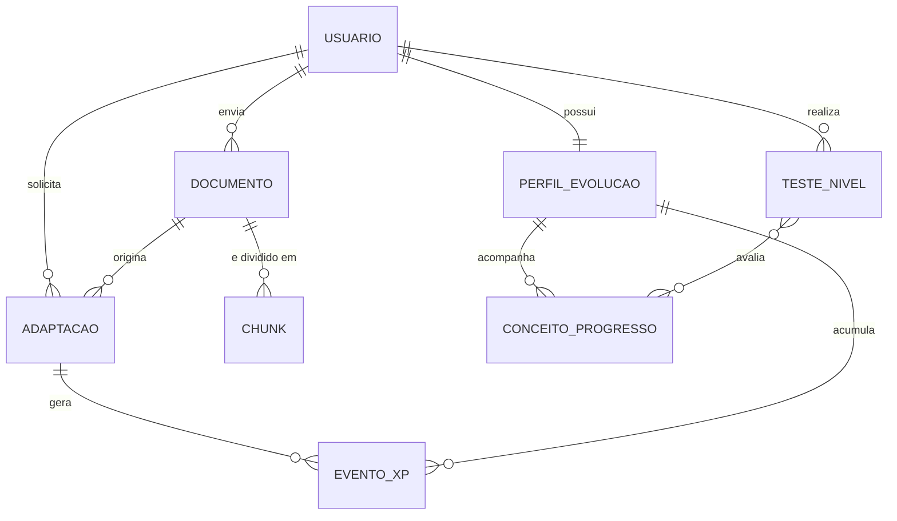

# 03 - Modelo de Domínio

> **Versão:** v2 · **Data:** 2026-10-17
> **Relacionados:** [02 - Requisitos](./02%20-%20Requisitos.md) · [05 - Contrato de API](./05%20-%20Contrato%20de%20API.md) · [ADR-0013](./adr/ADR-0013-postgresql-como-banco-de-leitura.md) · [ADR-0014](./adr/ADR-0014-pgvector-como-vector-store.md)

---

## 1. Visão geral

O domínio gira em torno de quatro ideias: o **usuário** (com sua evolução), o **documento** que ele envia, a **adaptação** gerada a partir dele e os **eventos** que alimentam a trilha de evolução (XP e testes).

`Analogia` não é uma tabela: as analogias de uma adaptação ficam dentro do JSON da própria adaptação (seção 2).

## 2. Entidades

> **Identificadores:** são strings opacas na API (o front não os interpreta). No banco são `UUID`. Os exemplos do contrato usam prefixos curtos (`usr-`, `doc-`) só por legibilidade.

### Usuario
| Campo | Tipo | Observação |
|---|---|---|
| `usuario_id` | UUID | Identificador estável |
| `nome` | texto | |
| `email` | texto | Normalizado em minúsculas, único |
| `senha_hash` | texto | bcrypt. Nunca texto puro (RN-14) |
| `nivel_declarado` | Nivel | Informado no cadastro (RN-01) |
| `criado_em` | datetime | |

### PerfilEvolucao
| Campo | Tipo | Observação |
|---|---|---|
| `usuario_id` | UUID | 1:1 com Usuario |
| `nivel_atual` | Nivel | Começa igual a `nivel_declarado` |
| `xp_total` | inteiro | Acumulado, nunca diminui |
| `teste_nivel_disponivel` | booleano | Derivado de `xp_total` e do limiar |
| `conceitos` | lista de ConceitoProgresso | |
| `historico` | lista de EventoXP | |
| `atualizado_em` | datetime | |

### Documento
| Campo | Tipo | Observação |
|---|---|---|
| `documento_id` | UUID | |
| `usuario_id` | UUID | Dono |
| `titulo` | texto | |
| `formato_origem` | enum | `pdf`, `markdown`, `texto` |
| `objeto_oci` | texto | Caminho do original no bucket |
| `status_upload` | enum | `pendente`, `concluido`, `falha` (RN-17) |
| `hash_conteudo` | texto | SHA-256, evita reindexar duplicatas por usuário |
| `nivel_documento_estimado` | Nivel (opcional) | Estimado **na ingestão** (RN-18). `null` se o LLM estiver indisponível nesse momento |
| `criado_em` | datetime | |

### Chunk
| Campo | Tipo | Observação |
|---|---|---|
| `chunk_id` | texto | Ex.: `chunk-001`, único por documento |
| `documento_id` | UUID | |
| `ordem` | inteiro | Posição no documento |
| `texto` | texto | |
| `embedding` | vetor(N) | Coluna `pgvector` no banco. N é a dimensão do modelo de embeddings (ADR-0011, ADR-0014) |

### Adaptacao (pacote educacional)
| Campo | Tipo | Observação |
|---|---|---|
| `adaptacao_id` | UUID | |
| `usuario_id`, `documento_id` | UUID | |
| `perfil_destinatario` | PerfilSaida | RN-02 |
| `formato_saida` | FormatoSaida | |
| `nicho_setor` | Nicho | |
| `nivel_detalhe` | NivelDetalhe | |
| `nivel_do_usuario_no_momento` | Nivel | Define a que nível pertencem seus conceitos |
| `resultado` | JSONB | O JSON completo da resposta (contrato, seção 5): `metadados`, `conteudo_adaptado`, `analogias` (EVO), `microlearning` (EVO), `avaliacao_qualidade` |
| `ancoragem_fonte_score` | decimal | Cópia do JSON em coluna, para listar e filtrar sem abrir o JSONB |
| `objeto_oci` | texto | JSON final no bucket |
| `status_upload` | enum | `pendente`, `concluido`, `falha` (RN-17) |
| `criado_em` | datetime | |

**Estrutura de uma analogia** (dentro de `resultado.analogias`, não é tabela):

| Campo | Tipo | Observação |
|---|---|---|
| `id` | texto | Ex.: `an-01` |
| `conceito` | texto | Conceito-chave explicado |
| `analogia` | texto | Texto da analogia |
| `mapeamento` | lista de pares | Termo técnico ↔ elemento da analogia |
| `limite_da_analogia` | texto | Onde a analogia deixa de valer |
| `ancorada_na_fonte` | booleano | Sempre `false` (RN-10) |
| `conceito_ancorado_em` | lista de chunk_id | Âncora do conceito na fonte |
| `fontes_externas` | lista de URL | Vazia no MVP (RN-13) |

### ConceitoProgresso
| Campo | Tipo | Observação |
|---|---|---|
| `conceito` | texto | Nome normalizado |
| `nivel_origem` | Nivel | Nível do usuário quando o conceito apareceu |
| `estado` | enum | `em_aprendizado` ou `dominado` |
| `acertos_quiz` | inteiro | Acertos acumulados |

Um conceito passa a `dominado` quando o usuário acerta o conceito no Teste de Nível **ou** acumula 2 acertos em quizzes sobre ele.

### EventoXP
| Campo | Tipo | Observação |
|---|---|---|
| `evento_id` | UUID | |
| `tipo` | enum | `geracao_conteudo`, `acerto_quiz` |
| `xp` | inteiro | +10 ou +5 (RN-03, RN-04) |
| `adaptacao_id` | UUID | Origem |
| `item_indice` | inteiro (opcional) | Pergunta do quiz, só em `acerto_quiz` |
| `criado_em` | datetime | |

### TesteNivel
| Campo | Tipo | Observação |
|---|---|---|
| `teste_id` | UUID | |
| `usuario_id` | UUID | |
| `nivel_avaliado` | Nivel | Nível atual no momento do teste |
| `perguntas` | lista | De 5 a 8, geradas dos conceitos e chunks do nível |
| `respostas` | lista | |
| `percentual_dominio` | decimal | Acertos ponderados por conceito |
| `aprovado` | booleano | `percentual_dominio >= limiar_aprovacao` (RN-07) |
| `tentativa` | inteiro | |
| `criado_em` | datetime | |

## 3. Enumerações

| Enum | Valores (no JSON, sem acentos) |
|---|---|
| `Nivel` | `Iniciante`, `Desenvolvedor Junior`, `Desenvolvedor Pleno`, `Tech Lead`, `Arquiteto` |
| `PerfilSaida` | Os 5 níveis acima + `Gestor/Executivo` |
| `FormatoSaida` | `Tutorial`, `Flashcards`, `Quiz`, `Resumo Executivo`, `Roteiro de Aula` |
| `Nicho` | `Geral`, `Fintech`, `Saude`, `E-commerce` |
| `NivelDetalhe` | `Didatico`, `Intermediario`, `Aprofundado` |
| `StatusUpload` | `pendente`, `concluido`, `falha` |

## 4. Máquinas de estado

**Conceito:** `em_aprendizado` → `dominado` (acerto no Teste de Nível ou 2 acertos em quiz). Não há retorno automático.

**Teste de Nível:** `indisponivel` → `disponivel` (XP ≥ limiar) → `em_andamento` → `aprovado` (nível sobe) ou `reprovado` (volta a `disponivel`, nova tentativa).

**Nível do usuário:** só avança por aprovação no Teste de Nível. Não há rebaixamento.

**Envio ao bucket** (`status_upload`, em documentos e adaptações): `pendente` → `concluido`, ou `pendente` → `falha` → `concluido` (após reenvio idempotente). Não volta de `concluido` para outro estado.

## 5. Invariantes

1. `xp_total` nunca diminui.
2. Um acerto de quiz concede XP **uma única vez** por pergunta e adaptação.
3. No máximo 3 eventos `geracao_conteudo` pontuam por dia civil (America/Sao_Paulo).
4. Toda analogia tem `ancorada_na_fonte = false` e ao menos um `conceito_ancorado_em`.
5. Todo item de conteúdo ancorado tem ao menos um chunk em `fontes_chunks`.
6. `senha_hash` nunca aparece em respostas da API nem em logs.
7. O e-mail é único (índice único sobre `lower(email)`).
8. O resultado de uma adaptação, os eventos de XP e a atualização do perfil são gravados na **mesma transação** (RNF-14).
9. Toda consulta de chunks é filtrada por `documento_id` de um documento do usuário do token.

## 6. Layout dos objetos no OCI Object Storage

Um único bucket Always Free (`AdaptAI-conteudos-educativos`). Ele é **arquivo e evidência**: o front-end não lê dele (ADR-0013).

| Prefixo | Conteúdo |
|---|---|
| `documentos/{usuario_id}/{documento_id}/{arquivo_original}` | Documento original enviado. Fonte para reconstruir `documentos` e `chunks` |
| `adaptacoes/{usuario_id}/{objeto_id}.json` | Pacote educacional gerado. Ex.: `conteudo-vcn-iniciante-flashcards-001.json`. Sempre com o gabarito completo |
| `backups/postgres/{data}.dump` | Backup periódico do banco (`pg_dump`). É a única cópia fora do banco de usuários, perfis, XP e testes |

**O que não está no bucket:** usuários, perfis, eventos de XP e testes de nível existem apenas no banco. Os objetos `perfis/`, `usuarios/`, `indices/email/` e `testes_nivel/` do desenho anterior (ADR-0005) deixam de existir.

**Consistência:** a gravação no banco vem primeiro e o envio ao bucket depois (RN-17). Se o envio falhar, `status_upload = falha` e um script idempotente reenvia as pendências. O que é reconstruível a partir do bucket: documentos, chunks (reindexação) e adaptações. O que não é: usuários, perfis e XP, protegidos pelo backup.

## 7. Esquema do banco (PostgreSQL)

Esquema gerenciado por **migrações Alembic** com **SQLAlchemy 2.x**. A tabela abaixo é o ponto de partida; os tipos exatos saem do spike da semana 1.

| Tabela | Colunas principais | Restrições e índices |
|---|---|---|
| `usuarios` | `usuario_id` PK, `nome`, `email`, `senha_hash`, `nivel_declarado`, `criado_em` | Único em `lower(email)`; `nivel_declarado` com `CHECK` nos 5 valores |
| `perfis_evolucao` | `usuario_id` PK e FK, `nivel_atual`, `xp_total`, `atualizado_em` | `xp_total >= 0`. A linha é travada (`SELECT ... FOR UPDATE`) ao aplicar XP |
| `documentos` | `documento_id` PK, `usuario_id` FK, `titulo`, `formato_origem`, `objeto_oci`, `status_upload`, `hash_conteudo`, `nivel_documento_estimado`, `criado_em` | Único em (`usuario_id`, `hash_conteudo`); índice em (`usuario_id`, `criado_em` desc) |
| `chunks` | `documento_id` FK, `chunk_id`, `ordem`, `texto`, `embedding vector(N)` | PK (`documento_id`, `chunk_id`); `ON DELETE CASCADE`; índice vetorial só se a medição pedir (ADR-0014) |
| `adaptacoes` | `adaptacao_id` PK, `usuario_id` FK, `documento_id` FK, parâmetros, `nivel_do_usuario_no_momento`, `resultado` JSONB, `ancoragem_fonte_score`, `objeto_oci`, `status_upload`, `criado_em` | Índice em (`usuario_id`, `criado_em` desc); índice em `documento_id` |
| `eventos_xp` | `evento_id` PK, `usuario_id` FK, `adaptacao_id` FK, `tipo`, `xp`, `item_indice`, `criado_em` | Índice único parcial em (`adaptacao_id`, `item_indice`) para `tipo = 'acerto_quiz'` (XP uma vez por pergunta) |
| `conceitos_progresso` | `usuario_id` FK, `conceito`, `nivel_origem`, `estado`, `acertos_quiz` | PK (`usuario_id`, `conceito`) |
| `testes_nivel` | `teste_id` PK, `usuario_id` FK, `nivel_avaliado`, `perguntas` JSONB, `respostas` JSONB, `percentual_dominio`, `aprovado`, `tentativa`, `criado_em` | Índice em (`usuario_id`, `criado_em` desc) |

**Regras de acesso:** o repositório nunca lê por id sozinho: sempre `id` **e** `usuario_id` do token, o que garante o 404 para recursos de outro usuário.

**Teto diário de gerações** (invariante 3): contado dentro da transação, com a linha do perfil travada, pelos eventos `geracao_conteudo` do dia civil em America/Sao_Paulo.

**Índice vetorial:** a coluna `embedding` é recriada por script a partir dos originais no bucket quando necessário (ADR-0014). Os chunks são determinísticos: mesmo documento e mesma configuração geram os mesmos `chunk_id`.
