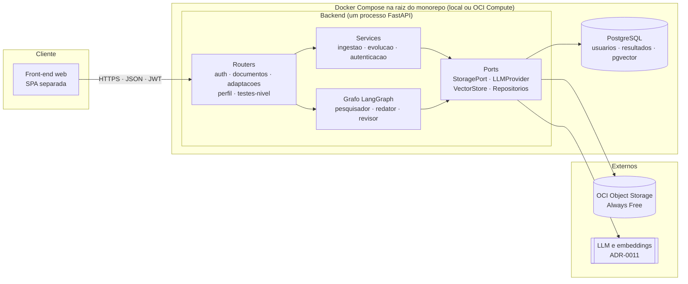
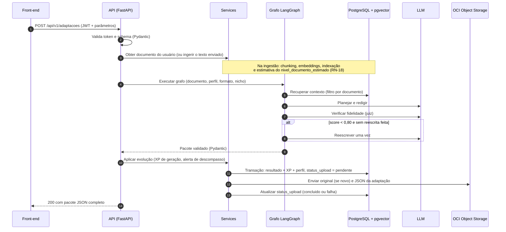
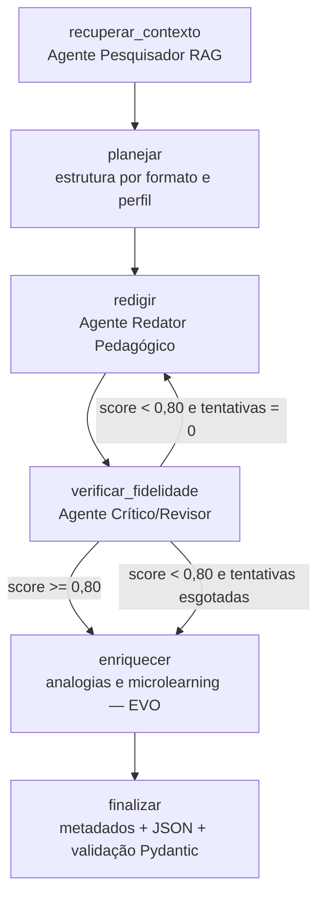

# 04 - Arquitetura

> **Versão:** v2 · **Data:** 2026-10-17
> **Relacionados:** [03 - Modelo de Domínio](./03%20-%20Modelo%20de%20Dom%C3%ADnio.md) · [05 - Contrato de API](./05%20-%20Contrato%20de%20API.md) · [ADRs](./adr/README-ADR.md)

---

## 1. Direcionadores arquiteturais

| Direcionador | Consequência |
|---|---|
| Prazo de 5 semanas e 2 dias (18/10 a 24/11/2026), front e back em paralelo | Arquitetura simples e **contrato primeiro** (schemas Pydantic e OpenAPI) |
| Fidelidade à fonte | RAG com rastreio de chunks e verificação de fidelidade no próprio grafo |
| Camada Always Free da OCI | Object Storage é o único serviço da OCI obrigatório. O banco roda em container, sem serviço pago |
| Front-end precisa listar e filtrar o histórico | PostgreSQL como fonte de leitura; bucket como arquivo e evidência (ADR-0013) |
| Demo ao vivo | Fluxo síncrono, modo demo, usuário de seed e `docker compose up` (ADR-0015) |
| Equipe aprendendo | "Tecnologia sem graça por padrão": FastAPI, PostgreSQL com `pgvector`, LangGraph. Um processo de backend, sem serviços extras |

## 2. Visão de componentes



**Regra de dependência:** routers dependem de services e do grafo; estes dependem de **ports** (interfaces); as implementações concretas (PostgreSQL, OCI, provedor de LLM) ficam isoladas. Isso permite testar sem rede (armazenamento local, repositórios em memória e LLM falso) e trocar provedores sem tocar na regra de negócio.

**API, backend e RAG são camadas do mesmo processo**, não serviços separados (ADR-0015). O diagrama de contexto da equipe, que mostra "API FastAPI", "Backend" e "Serviço RAG" como caixas distintas, representa **fronteiras lógicas** (pastas `api`, `services`, `agents` e `rag`), não containers.

## 3. Fluxo principal: adaptar um documento



Se o envio ao bucket falhar (passo 11), o resultado **já está no banco**, a resposta traz `armazenamento_oci.status_upload = "falha"` e um script idempotente reenvia as pendências (RN-17). O usuário não perde o conteúdo por causa da nuvem.

## 4. Grafo de agentes (LangGraph)



| Nó | Responsabilidade | Observações |
|---|---|---|
| `recuperar_contexto` | Busca os chunks relevantes | Documentos curtos (até ~12 chunks) entram inteiros no contexto. Documentos longos usam busca por tópico do plano |
| `planejar` | Define estrutura, número de itens e foco por perfil, formato e nicho | Role prompting. **Não** estima o nível do documento: isso acontece na ingestão (RN-18) |
| `redigir` | Gera o conteúdo no formato pedido, com saída estruturada | Few-shot por formato; cada item cita `fontes_chunks`. Linguagem figurada permitida sem afirmar fatos novos (RN-19) |
| `verificar_fidelidade` | Calcula o score e lista afirmações sem suporte (ADR-0010) | No máximo **uma** reescrita (RN-12). Avalia só afirmações factuais (RN-19) |
| `enriquecer` | Gera analogias e blocos de microlearning | Ativado por flags. Entra nas semanas 4 e 5 (E8, E9) |
| `finalizar` | Monta metadados, valida o JSON e prepara a persistência | Uma nova tentativa se a validação Pydantic falhar |

**Estado do grafo** (resumo): `documento`, `chunks_recuperados`, `parametros`, `plano`, `rascunho`, `avaliacao`, `tentativas_reescrita`, `analogias`, `microlearning`, `pacote_final`.

**Guarda-corpos:** conteúdo do documento sempre dentro de delimitadores no prompt e tratado como dado (RNF-03); limite de tempo por nó e total; registro de latência e tokens por nó (RNF-09).

**Sobre o termo "multi-agente":** o grafo tem um fluxo praticamente linear com **uma aresta condicional** (a reescrita) e **não tem nó roteador**. Os nós têm papéis de pesquisador, redator e crítico, mas `recuperar_contexto` é uma etapa de recuperação, não um agente autônomo. O README deve descrever o que existe, sem inflar o rótulo.

## 5. Pipeline RAG

**Ingestão** (acontece uma vez por documento)

1. **Extração:** PDF com PyPDF, Markdown e texto como leitura direta. PDF sem texto extraível (digitalizado) retorna `DOCUMENTO_SEM_TEXTO`.
2. **Normalização:** limpeza de quebras e cabeçalhos repetidos.
3. **Chunking:** `RecursiveCharacterTextSplitter`, ponto de partida de 900 caracteres com 150 de sobreposição (calibrar na semana 2). `chunk_id` determinístico (`chunk-001`, ...).
4. **Embeddings:** modelo definido no ADR-0011, com suporte a português.
5. **Indexação:** linhas na tabela `chunks`, com a coluna `embedding` do `pgvector` (ADR-0014). Toda consulta filtra por `documento_id` de um documento do usuário, o que impede vazamento entre usuários.
6. **Nível do documento:** uma chamada ao LLM sobre uma amostra do texto estima `nivel_documento_estimado` e guarda no banco (RN-18). Se o LLM falhar nesse momento, o campo fica `null` e o alerta de descompasso não é emitido para esse documento. A ingestão não falha por isso.

**Recuperação:** `top_k` inicial de 6 por consulta, métrica por cosseno, com deduplicação e ordenação pela posição no documento.

**Índice reconstruível (ADR-0014):** o original no bucket (`documentos/`) é a fonte para recriar `documentos` e `chunks`. Um script de reindexação faz isso sob demanda. Trocar o modelo de embeddings exige reindexar todos os documentos.

**Risco conhecido:** como documentos curtos entram inteiros no contexto, a busca vetorial pode ser indexada mas nunca exercitada na geração. Pelo menos um cenário de demonstração deve usar um documento longo o bastante para a recuperação acontecer, e `chunks_utilizados` deve refletir isso.

## 6. Verificação de fidelidade (resumo)

1. O conteúdo gerado é decomposto em afirmações verificáveis.
2. Um juiz LLM confere cada afirmação contra os chunks recuperados (suportada, parcial ou não suportada).
3. `ancoragem_fonte_score` = proporção de afirmações suportadas (parciais contam metade).
4. **Só afirmações factuais entram na conta** (RN-19). Metáforas e linguagem figurada na introdução e nas dicas não são julgadas, desde que não acrescentem fatos técnicos.
5. `fidelidade_analogias_score` mede se o mapeamento de cada analogia corresponde a conceitos da fonte. **Analogias não entram no score principal** (RN-10).
6. O score é sempre entregue com `chunks_utilizados` e observações.

Detalhes e alternativas no [ADR-0010](./adr/ADR-0010-verificacao-de-fidelidade-por-juiz-llm.md).

## 7. Estrutura do repositório

```text
AdaptAI/
├── backend/
│   ├── app/
│   │   ├── main.py                 # criação do app, CORS, handlers de erro
│   │   ├── config.py               # settings (pydantic-settings) lidos do ambiente
│   │   ├── api/                    # routers: auth, documentos, adaptacoes, perfil, testes_nivel
│   │   ├── schemas/                # modelos Pydantic de entrada e saída (contrato)
│   │   ├── domain/                 # regras puras: xp, niveis, conceitos (sem I/O)
│   │   ├── services/               # ingestao, autenticacao, evolucao, adaptacao
│   │   ├── agents/                 # grafo LangGraph, nós, prompts, few-shots
│   │   ├── rag/                    # extração, chunking, embeddings, recuperação
│   │   ├── ports/                  # interfaces: StoragePort, LLMProvider, VectorStore, repositórios
│   │   └── infra/                  # oci_storage, local_storage, db (SQLAlchemy), llm_*
│   ├── migrations/                 # Alembic
│   ├── tests/
│   ├── scripts/                    # seed do usuário demo, reindexação, reenvio de pendências, backup
│   ├── Dockerfile
│   └── pyproject.toml
├── frontend/                       # SPA separada (ADR-0012)
│   └── Dockerfile
├── docs/                           # esta documentação (+ adr/ e prd/)
├── docker-compose.yml              # db (postgres + pgvector), backend, frontend
├── .env.example                    # modelo de variáveis, sem valores reais
└── README.md                       # visão, diagrama, guia de instalação
```

## 8. Integração com a OCI

- Acesso via **OCI SDK para Python** (`oci`), autenticação por chave de API configurada por variáveis de ambiente. Se o deploy na VM acontecer, avaliar *instance principals* para dispensar a chave na VM (exige política de IAM; confirmar no spike).
- Toda chamada passa por `StoragePort`. Implementações: `OCIObjectStorage` (demo e VM) e `LocalFileStorage` (desenvolvimento e testes).
- **Spike da semana 1 (US-006):** limitado a meio dia. Criar o bucket, validar credenciais e testar upload, download e listagem por prefixo. **Depende de a conta OCI existir**; criar a conta e escolher a região principal são os passos de maior incerteza (cadastro com cartão, verificação, e a região não pode ser trocada depois).
- Respeitar as cotas da camada Always Free (verificar armazenamento e número de requisições no console). Nenhum outro serviço pago deve ser habilitado.
- Layout dos objetos em [03 - Modelo de Domínio](./03%20-%20Modelo%20de%20Dom%C3%ADnio.md#6-layout-dos-objetos-no-oci-object-storage).

## 9. Segurança

| Tema | Decisão |
|---|---|
| Autenticação | JWT (HS256) com expiração configurável (padrão 60 min). Senha com bcrypt (ADR-0006) |
| Autorização | Todo recurso é filtrado por `usuario_id` do token, **na consulta ao banco**. Acesso a recurso de outro usuário retorna 404 |
| Token no front | Decisão aberta (PRD-002): avaliar memória ou `sessionStorage` em vez de `localStorage`, que é mais exposto a XSS. A expiração curta reduz o risco |
| Upload | Tipos PDF, MD e TXT; máximo de 10 MB; nome de arquivo sanitizado |
| CORS | Somente a origem do front-end configurada |
| Segredos | Variáveis de ambiente e `.env` fora do Git, inclusive a senha do banco. `.env.example` sem valores |
| Banco | Não exposto fora da rede do Compose. Credenciais próprias, nunca as padrão da imagem |
| Prompt injection | Documento como dado não confiável, delimitado no prompt; saída sempre validada por schema |
| Dados pessoais | Apenas nome, e-mail e hash de senha. Nada disso aparece em logs |

## 10. Observabilidade

Logs estruturados em JSON com `request_id`, rota, usuário (identificador, nunca e-mail), duração e, para o grafo, latência e tokens por nó. Endpoint `GET /health` verifica a API, o banco (inclusive a extensão `pgvector`) e o acesso ao bucket.

## 11. Configuração (variáveis de ambiente)

| Variável | Descrição |
|---|---|
| `AdaptAI_ENV` | `dev`, `demo` ou `prod` |
| `AdaptAI_MODO_DEMO` | `true` aplica fator 0,1 aos limiares de XP (RN-16) |
| `JWT_SECRET`, `JWT_EXPIRA_MIN` | Assinatura e validade do token |
| `CORS_ORIGINS` | Origens permitidas |
| `MAX_UPLOAD_MB` | Limite de upload (padrão 10) |
| `DATABASE_URL` | Conexão com o PostgreSQL (no Compose, o host é o serviço `db`) |
| `POSTGRES_USER`, `POSTGRES_PASSWORD`, `POSTGRES_DB` | Credenciais do container do banco |
| `STORAGE_BACKEND` | `oci` ou `local` |
| `OCI_REGION`, `OCI_TENANCY`, `OCI_USER`, `OCI_FINGERPRINT`, `OCI_KEY_FILE`, `OCI_NAMESPACE`, `OCI_BUCKET` | Acesso ao Object Storage |
| `LLM_PROVIDER`, `LLM_MODEL`, `LLM_API_KEY` | Provedor de LLM (ADR-0011) |
| `EMBEDDING_MODEL`, `EMBEDDING_DIM` | Modelo de embeddings e a dimensão da coluna `vector` (ADR-0014) |

## 12. Execução e implantação

- **Desenvolvimento e demonstração principal:** `docker compose up` na raiz sobe `db`, `backend` e `frontend`. A mesma configuração roda no notebook de quem avalia. Com `STORAGE_BACKEND=local` o bucket é dispensado; com `oci` a demonstração usa o bucket real.
- **Volumes:** o banco usa volume nomeado. O `pg_dump` periódico para `backups/` no bucket protege usuários, perfis e XP.
- **Opcional (semana final):** hospedar o mesmo Compose em uma VM Always Free na OCI Compute (US-093). Pontos de atenção, a conferir na documentação vigente da Oracle:
  - A VM AMD (`VM.Standard.E2.1.Micro`) tem 1 GB de memória e **não comporta** banco, backend com embeddings e front-end juntos.
  - A VM Arm (`VM.Standard.A1.Flex`) tem até 4 OCPUs e 24 GB no total, mas exige imagens e dependências para **arm64**, e a criação pode falhar por falta de capacidade na região.
  - Instâncias Always Free ociosas podem ser recuperadas pela Oracle; entre a primeira entrega e a fase final pode haver dias sem uso.
  - Confirmar no console que o *shape* é elegível à camada Always Free antes de criar.
  - O consumo de memória do conjunto ainda não foi medido.

## 13. Riscos técnicos e mitigações

| Risco | Mitigação |
|---|---|
| Conta OCI inexistente e integração deixada para o fim | Criar a conta, escolher a região e fazer o spike (meio dia) até o fim da semana 1; `LocalFileStorage` para não bloquear o desenvolvimento |
| Duas persistências (banco e bucket) divergem | `status_upload`, reenvio idempotente e reindexação a partir do bucket (RN-17) |
| Estado do banco perdido (volume apagado, VM recuperada) | `pg_dump` periódico para o bucket e script de restauração; volume nomeado no Compose |
| Score de fidelidade instável | Temperatura baixa no juiz, conjunto de 3 cenários como referência, score sempre acompanhado das fontes |
| Limites e latência do LLM gratuito | Abstração de provedor, cache por hash (documento, parâmetros), uma reescrita no máximo, timeout por nó. A meta de 45 s ainda não tem medição |
| Troca do modelo de embeddings | Dimensão fixa por modelo: decidir o ADR-0011 cedo; reindexar se mudar |
| Imagem do Postgres sem `pgvector` ou sem build para arm64 | Confirmar a imagem no spike da semana 1 |
| Saída do LLM fora do schema | Saída estruturada, validação Pydantic e uma nova tentativa |
| Contexto longo demais | Busca por tópico para documentos longos, limite de páginas na demo |
| Busca vetorial nunca exercitada com documentos curtos | Ao menos um cenário com documento longo; `chunks_utilizados` visível |
| VM Always Free sem memória, sem capacidade ou recuperada por ociosidade | A VM é bônus; a demonstração principal roda local (ADR-0015) |

## 14. Estratégia de testes

Testar o que quebra de verdade, sem perseguir cobertura:

- **Regras puras** (`domain/`): XP, teto diário, limiares, promoção, domínio de conceitos. Testes unitários com `pytest`.
- **Contrato da API:** testes com `LocalFileStorage`, repositórios em memória e LLM falso, cobrindo autenticação, validação e códigos de erro.
- **Banco:** testes de integração contra o PostgreSQL do Compose, para o que só o banco garante: e-mail único, XP uma vez por pergunta e transação do resultado com o XP.
- **Chunking determinístico:** mesmo documento gera os mesmos `chunk_id`.
- **Fumaça dos 3 cenários de demo:** execução real e manual antes de cada marco, conferindo scores e schema. A **qualidade textual do LLM não é testada com teste unitário**.
